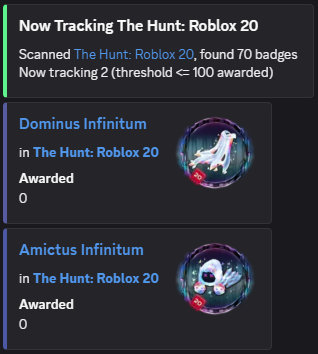
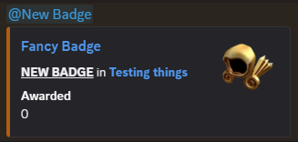
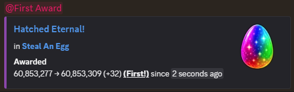
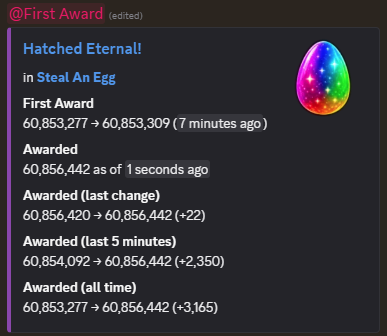
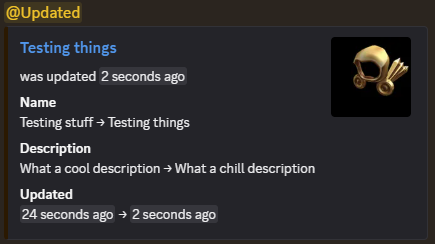
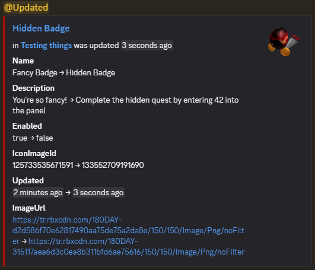
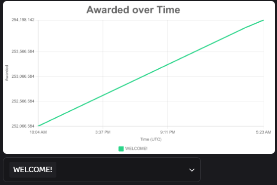

<div align="center">

# Roblox Badge Tracker

[](https://github.com/ThatTimothy/roblox-badge-tracker/releases/latest)
[](LICENSE)

A simple discord bot to track games and their badges

</div>

# Features
- Built for tracking event games on Roblox & battle-tested against them
- Easy use through Discord commands, configuring & receiving updates from anywhere
- Track games & badges, new badges automatically tracked
- Automatic updates for awarded count for badges
- Notifications for first award, game/badge updated, new badges (mentions fully configurable to users or roles)
- Awarded history graphing & export

## Game & Badge Tracking
Track a game with a single command, selecting badges by an optional threshold (perfect for tracking likely event badges) \


New badges are automatically tracked and notified (regardless of initial threshold) \


## Tracking Awarded Count
Notification for first award \


Following a live updating embed (no spamming channel repeatedly) containing awarded information over several timespans \
 \
*Tip: to make the embed jump to the bottom of a channel, simply delete it! The next update will create a brand new message.*

## Tracking updates
Notification for game & badge updates \
 \


## Awarded History
Display a graph of award history (supports multiple badges & exporting to csv) \


# Setup

Setup is pretty simple - you will need a Discord bot, Roblox API key, and a place to run the tracker.

## Create and add the bot to the guild

Create a bot on the [Discord Developer Portal](https://discord.com/developers/applications/)

The bot requires the `Send Messages` and `View Channels` permission for the channel you wish to use it in. No additional permissions are required.

## Configure Secrets

Next, the following values must be placed into a `.env` file:

- `API_KEY` - [an Roblox API key](https://create.roblox.com/dashboard/credentials) provisioned to be used - requires no permissions
- `BOT_TOKEN` - the [token of the discord bot](https://discord.com/developers/applications/)
- `CLIENT_ID` - the id of the bot's user client (also known as "Application Id" on the discord developers portal)

## Register Commands

Before running the bot, you must register the commands the bot will use. This is in a separate script so as to not hit discord rate limits for command updating.

```sh
npm run build
npm run register-commands
```

You should see `Successfully reloaded x application (/) commands globally.`

Once doing so, ensure you can type `/` into the chat and see the commands pop up from your bot (this can take a few minutes)

## Running

To run, simply do

```sh
npm run build
node out/index.js
```

and you should see the bot come online!

## Stopping

To stop, you can do `Ctrl+C`, `Ctrl+D`, or `q`. Before stopping, data will be saved. On the next start, tracking will resume from the saved state.

Saves happen automatically every 5 minutes, but you can use `s` to manually save.

# Usage

## `/setup (log-channel) (first-award-notification) (updated-notification) (new-badge-notification)`

Set up the configuration for the bot (all configuration is listed below.)
Running without any arguments (`/setup`) will launch an **interactive menu which walks through each setting - this is recommended for first setup**.
If you want to quickly update one of the configurations without going through each setting, you can use the optional arguments - for example: `/setup log-channel:#log`

**Make sure you set the log-channel or no updates will be logged!**

### Log Channel
The channel to log updates in

### First Award Notification
The users/roles mentioned when a tracked badge receives its first award

### Updated Notification
The users/roles mentioned when a tracked game or badge is updated

### New Badge Notification
The users/roles mentioned when a tracked game has a new badge added

## `/tracking games`

Logs all the games being tracked.

## `/tracking badges`

Logs all the badges being tracked.

## `/award-history (link) (raw)`

Displays a graph of awarded over time for all tracked badges or an optional specific tracked badge.

If raw is specified, an exported csv of award history will be attached. Note: only works with a specific badge, not all.

## `/track game [link] (max-awarded)`

Tracks a specific game's badges.

`max-awarded` can be specified to filter the maximum awarded count to include. Set to `-1` to include all badges from a game.
If not specified, defaults to 100. As an example, if `max-awarded` is 1000, only badges with 1000 or less awards would be tracked.
This only applies to the initial scan - any new badges will be included regardless.

## `/track badge [link]`

Tracks a specific badge.

## `/untrack game [link]`

Stops tracking a game. Note that this will untrack any badges under this game.

## `/untrack badge [link]`

Stops tracking a badge.

# License

The license can be found in [`LICENSE`](./LICENSE)

# Contributing

If you find any bugs or make a new feature, feel free to make a pull request!
